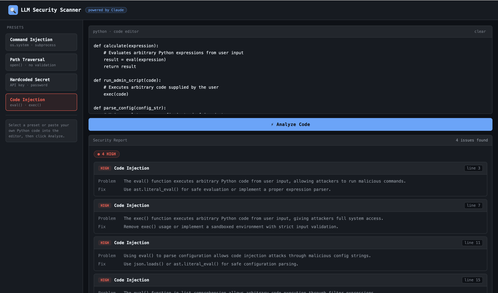

# LLM Security Scanner

A security analysis tool that uses **Claude (claude-sonnet-4-20250514)** to detect vulnerabilities in Python source code. Identifies issues like command injection, path traversal, hardcoded secrets, and code injection — with severity ratings and fix suggestions.

Built as a research prototype exploring LLM-based static analysis for open-source software security. This is a small side project using a hosted LLM API; it is separate from my thesis research.

> **Privacy:** the code you scan is sent to Anthropic's API. Do not scan proprietary or sensitive code.
>
> **Note:** all credentials in `examples/` and in the web demo samples are fake and for demonstration only.

---

## Features

- **4 vulnerability types** detected out of the box: Command Injection, Path Traversal, Hardcoded Secrets, Code Injection
- **Severity classification**: HIGH / MEDIUM / LOW
- **Line-level precision**: points to the exact line of vulnerable code
- **Fix suggestions**: actionable recommendations for each issue
- **Two interfaces**: interactive web demo + CLI tool

---

## Project Structure

```
llm-security-scanner/
├── index.html              # Web demo (requires server.py)
├── server.py               # Flask server (bridges browser and API)
├── scanner.py              # CLI tool
├── examples/
│   ├── command_injection.py
│   ├── path_traversal.py
│   ├── hardcoded_secret.py
│   └── code_injection.py
└── README.md
```

---

## Setup

### 1. Get an Anthropic API key

1. Go to [console.anthropic.com](https://console.anthropic.com) and sign up
2. Click **API Keys** → **Create Key**
3. Add a credit card and top up a minimum of **$5** (pay-as-you-go, not a subscription)
4. Copy your key — it starts with `sk-ant-...`

> ⚠️ Note: Claude Pro (claude.ai subscription) does NOT include API access. The API is billed separately.

### 2. Set your API key

**macOS / Linux:**
```bash
export ANTHROPIC_API_KEY=sk-ant-your_key_here
```

**Windows (PowerShell):**
```powershell
$env:ANTHROPIC_API_KEY = "sk-ant-your_key_here"
```

### 3. Install dependencies

```bash
pip3 install anthropic flask flask-cors
```

---

## Usage

### Web Demo

The web demo requires the local Flask server to proxy requests to the Anthropic API.

```bash
# Start the server
python3 server.py

# Then open in your browser
http://localhost:5000
```

1. Select a preset from the left panel, or paste your own Python code
2. Click **Analyze Code**
3. View the security report with severity badges and fix suggestions

### CLI Tool

```bash
python3 scanner.py <path_to_file>
```

**Examples:**

```bash
# Scan a preset example
python3 scanner.py examples/command_injection.py

# Scan your own code
python3 scanner.py myproject/app.py
```

**Sample output:**

```
============================================================
  LLM Security Scanner — powered by Claude
============================================================

Scanning: examples/command_injection.py
Sending to Claude for analysis...

Summary:  2 HIGH  0 MEDIUM  1 LOW

Issues found:

Issue 1
  Type      Command Injection
  Severity  HIGH
  Line      line 6
  Problem   os.system() passes raw user input directly to the shell
  Fix       Use subprocess.run() with a list of arguments and shell=False
...
```

---

## Example Vulnerabilities

| File | Vulnerability | Severity |
|------|--------------|----------|
| `command_injection.py` | `os.system(user_input)` | HIGH |
| `path_traversal.py` | `open(filename)` without validation | MEDIUM |
| `hardcoded_secret.py` | API keys in source code | HIGH |
| `code_injection.py` | `eval(user_input)` | HIGH |

---

## How It Works

1. The tool reads the Python source file
2. Sends it to Claude with a structured security analysis prompt
3. Claude returns a JSON array of detected issues
4. The tool renders results with severity, location, and fix suggestions

The prompt instructs Claude to act as a security analyst and return structured JSON — enabling reliable parsing and display.

---

## Screenshot




---

## Limitations

- Analysis quality depends on the LLM — may produce false positives or miss subtle issues
- Best used as a complement to traditional static analysis tools (Bandit, Semgrep)
- Currently supports Python only

---

## Related Work

This prototype is inspired by research on using LLMs for automated security assessment of open-source repositories, including vulnerability detection, malware pattern recognition, and supply-chain security analysis.

---

## Author

**Luyao Ma**
M.Sc. Artificial Intelligence — University of Bologna
[github.com/LuyaoMa-ace](https://github.com/LuyaoMa-ace)

---

## Docker (recommended)

Run the web demo in a container — no Python installation needed.

### Option A: Docker Compose (easiest)

```bash
# Set your API key
export ANTHROPIC_API_KEY=sk-ant-your_key_here

# Build and start
docker compose up

# Open in browser
http://localhost:5000
```

### Option B: Docker only

```bash
# Build the image
docker build -t llm-security-scanner .

# Run the container
docker run -p 5000:5000 -e ANTHROPIC_API_KEY=sk-ant-your_key_here llm-security-scanner

# Open in browser
http://localhost:5000
```

### Stop the container

```bash
docker compose down
```
